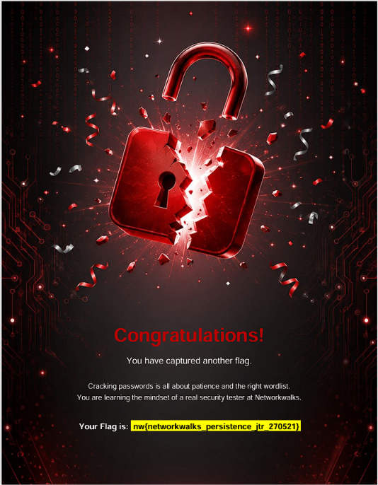

# Password Cracking & Hash Analysis

## Project Overview

This repository documents my practical learning and hands-on experience with password cracking techniques as part of my cybersecurity training with **Networkwalks Academy**.

The project focuses on understanding password security, password hash extraction, offline password cracking and the use of password auditing tools, particularly John the Ripper.

Through practical exercises, I explored how password hashes can be analysed and how different password-cracking techniques can be applied in authorized cybersecurity testing environments.

## Learning Objectives

The main objectives of this project are to:

- Understand password hashing and password security.
- Learn how password hashes are extracted from supported file formats.
- Understand offline password-cracking techniques.
- Gain practical experience with John the Ripper.
- Explore dictionary-based and brute-force password attacks.
- Understand the importance of strong passwords and secure authentication.
- Develop practical ethical hacking and cybersecurity skills.

## Tools & Technologies

| Tool | Purpose |
|---|---|
| John the Ripper | Password hash auditing and cracking |
| PDF Hash Extractor | Extract password hashes from a file |
| Hash Calculator | Extract password hash |
| Password Cracker | Password has auditing and cracking |

## Links to some of the tools:
- [PDF Hash Extractor](https://www.onlinehashcrack.com/tools-pdf-hash-extractor.php)
- [Hash Calculator](https://networkwalks.com/hash-calculator/)
- [Password Cracker](https://networkwalks.com/password-cracker/)

## Techniques Explored

### 1. Password Hash Extraction

Learning how to extract password hashes from supported password-protected files for offline security testing.

### 2. Dictionary Attack

Using a wordlist containing possible passwords to identify passwords matching extracted hashes.

### 3. Brute-Force Attack

Understanding how password candidates can be systematically generated and tested against password hashes.

### 4. Offline Password Cracking

Performing password recovery attempts against extracted hashes without repeatedly interacting with the original login system.

### 5. Hash Analysis

Understanding different password hash formats and how password-cracking tools process them.

## Practical Exercises & Achievements

During the practical exercises, I successfully captured four flags provided through the Networkwalks Academy cybersecurity training activities.

The exercises helped strengthen my understanding of password cracking, wordlist usage and practical cybersecurity methodologies.

### Flag 1

Successfully captured my first flag during the cybersecurity exercises.

### Flag 2 

Successfully captured another flag, demonstrating continued progress through the practical exercises.

### Flag 3

Successfully captured another flag through continued password-cracking practice.

### Flag 4

This was done using the tools from networkwalks

## Key Learning Outcomes

Through these exercises, I developed a better understanding of:

- How password hashes are extracted and analysed.
- How dictionary attacks and brute-force attacks work.
- How John the Ripper assists in password security auditing.
- Why weak and predictable passwords are vulnerable.
- The importance of strong password policies and secure authentication.
- The role of ethical hacking in identifying security weaknesses.

## Ethical Considerations

All practical activities documented in this repository are intended for educational purposes and authorized cybersecurity testing.

Password auditing and cracking techniques should only be performed on files, systems and password hashes that you own or have explicit permission to test.

Unauthorized access to accounts, systems or information is not supported.

## Future Learning Goals

- Explore additional password hash formats.
- Understand password salting and hashing algorithms.
- Practise password auditing with different wordlists.
- Explore password-cracking performance and optimization.
- Learn more about password security and authentication mechanisms.

## Acknowledgements

Special thanks to **Networkwalks Academy** and its team of instructors (**Waqas Karim**) for providing the cybersecurity training, practical exercises and guidance throughout this learning journey.

I appreciate the opportunity to develop my technical knowledge through hands-on cybersecurity practice.

## Author

**Ako Vagi**

Computer Science Undergraduate | Cybersecurity Enthusiast | Aspiring Security Professional

- GitHub: [ako123-dev](https://github.com/ako123-dev/)
- LinkedIn: [My LinkedIn Profile](https://www.linkedin.com/in/ako-vagi-5559a2349/)

## Demonstration
### [John the ripper demo](https://youtu.be/MHheiz7NHEE)
### [Network walks Demo](https://youtu.be/_Z4cM-OUaeY)
